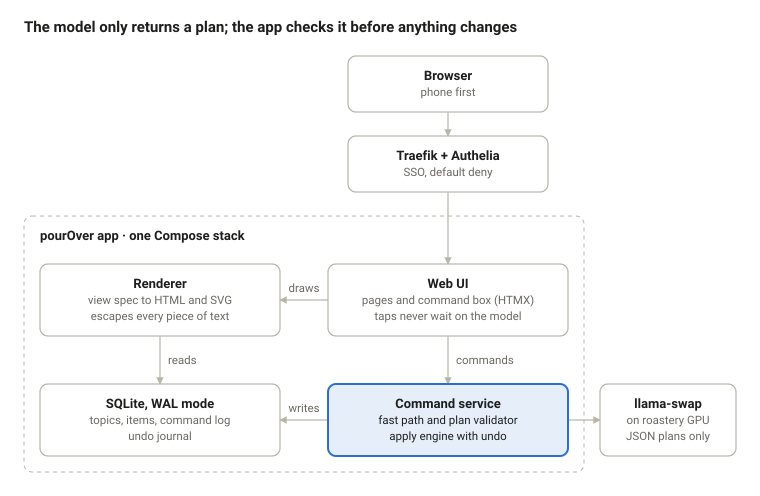
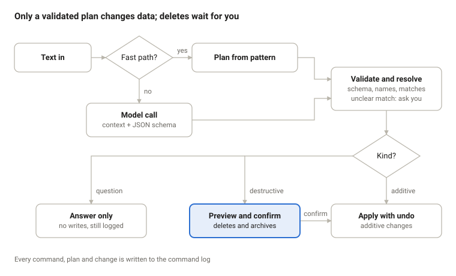

# Architecture

pourOver is one FastAPI service with SQLite and server-rendered pages. The model never writes code or markup: it returns a JSON plan, and the app validates that plan before anything changes.

## At a glance



Requests pass SSO before reaching the Web UI. Only the command service talks to the model or writes data; the renderer only reads.

## Command pipeline



Pattern and model plans go through the same validator, so the fast path gets no shortcut past the safety checks.

## Data model

Five tables. Fields and views live as JSON on the topic, so a new topic shape needs no migration.

| Table | Key fields | Notes |
| --- | --- | --- |
| topic | id, slug, title, template_key, fields (JSON), view_spec (JSON), theme (JSON), pinned, archived_at, created_by, last_opened_at | One page per topic |
| item | id, topic_id, title, values (JSON by field key), status (open or done), due_at, position, ai_suggested, created_by, completed_by, deleted_at | Soft delete; purged 30 days after deletion |
| command | id, user, text, path (fast or model), model, plan (JSON), outcome, error, latency_ms, created_at | One row per instruction, including rejected ones |
| change | id, command_id, entity, entity_id, before (JSON), after (JSON) | Undo journal; undo replays before-values |
| user | username, display_name, groups | Filled from Authelia headers on first visit |

Field types: text, number, date, choice (fixed options), yes/no, and quantity (number plus unit). Templates live as files in the repo, not in the database, so they are versioned in git.

## Operation plan

Every instruction becomes a plan: a list of operations from a fixed set. The fast path builds plans from patterns; the model builds them from free text under a JSON schema enforced by llama.cpp, so it cannot return anything else. Full example: [examples/plan.example.json](examples/plan.example.json).

```json
{
  "version": 1,
  "topic": { "ref": "groceries" },
  "ops": [
    { "op": "add_items", "items": [
      { "title": "Spinach", "values": { "quantity": 500, "unit": "g", "category": "Veg" } },
      { "title": "Paneer", "values": { "quantity": 200, "unit": "g", "category": "Dairy" } }
    ] }
  ],
  "answer": null
}
```

| Kind | Operations | Handling |
| --- | --- | --- |
| Additive | create_topic, rename_topic, pin_topic, set_fields (add only), add_items, update_items, complete_items, reopen_items, set_view, set_theme | Applied at once, undo offered |
| Destructive | remove_items, archive_topic, set_fields that drops a field | Preview, then wait for confirm |
| Read | answer | No writes; text shown in place |

Validation runs in this order, and any failure stops the plan:

1. Schema check with Pydantic, even though the grammar already constrains it.
2. Resolve references: the topic by slug or fuzzy title, fields by key, items by id or text match.
3. Ambiguous match (two items called "milk"): ask which, never guess.
4. Classify each operation and build a dry-run diff.
5. Apply in one transaction and write the change rows.

## View spec and widgets

Each topic's page is a view spec: data that picks widgets from a fixed kit. The model may write a view spec through set_view; the renderer turns it into HTML and SVG that it controls. Full example: [examples/view-spec.example.json](examples/view-spec.example.json).

```json
{
  "version": 1,
  "layout": "stack",
  "sections": [
    { "widget": "checklist", "title": "To buy", "filter": { "status": "open" },
      "group_by": "category", "show": ["quantity", "unit"] },
    { "widget": "checklist", "title": "In the basket", "filter": { "status": "done" },
      "collapsed": true }
  ]
}
```

| Widget | Parameters | Example use |
| --- | --- | --- |
| checklist | filter, group_by, sort, show (fields), collapsed | Groceries, chores |
| table | columns, filter, group_by, sort | Reading list, price comparison |
| bar | x (field, with week or month buckets for dates), y (field and sum, count or average), last N buckets | Pages read per week |

Renderer rules:

- Layouts: stack (one column) or split (two columns on desktop, one on a phone).
- Theme is three tokens per topic: accent (from a fixed coffee palette), density (comfortable or compact), icon (from a fixed set).
- Charts are server-side SVG. No chart library and no client-side JavaScript beyond HTMX.
- An unknown widget or missing field renders a "can't draw this section" card. The page never fails as a whole.
- All item and topic text is escaped. Nothing from the model or a user becomes markup.

## Templates and model context

A template is a basic template plus detailed instructions: fields, a default view, and plain-language rules the model follows for that kind of topic. Full file: [templates/groceries.yaml](templates/groceries.yaml).

```yaml
key: groceries
name: Groceries
fields:
  - { key: quantity, type: quantity }
  - { key: category, type: choice,
      options: [Veg, Fruit, Dairy, Staples, Spices, Meat and fish, Household, Other] }
view: default-checklist-by-category
instructions: |
  Expand dishes into ingredients for 2 people unless told otherwise.
  Use metric units. Keep the name the user typed (dhaniya stays dhaniya).
  Merge with existing open items instead of adding duplicates.
  Skip pantry basics (salt, oil, water) unless asked.
```

The model gets a bounded context per command, cut oldest-first when it runs long:

- System rules: the plan schema, the operation list, and "never invent topics the user didn't name".
- Topic index: slug, title and field keys of every active topic.
- The target topic's template instructions, fields and open item titles.
- Today's date and the user's text, fenced as data.

The 2-person default and the pantry-basics rule are proposals; change them in the template file, not in code.

## Stack and deployment

Boring on purpose: the same shape as scratchPost, deployed like every other purrBrews app.

| Part | Choice | Why |
| --- | --- | --- |
| App | Python, FastAPI, Jinja2 templates, HTMX | Matches scratchPost; no JavaScript build step |
| Storage | SQLite in WAL mode on a named volume | Two users don't need Postgres; one file to back up |
| Charts | Server-rendered SVG | No chart library; reusable on the wall screen and mirror later |
| Model | llama-swap on roastery, OpenAI-compatible endpoint, JSON schema output | Already merged in purrBrews; model picks need owner confirmation |
| Auth | Authelia forward auth through Traefik | Default deny is already in place |
| Host | grinder for beta, percolator once restore-tested | grinder holds nothing household-critical |
| Packaging | One Compose stack, pinned image, /healthz, restart unless-stopped, Gatus check | purrBrews defaults |
| Code | Public app repo under purrMonster; stack folder in purrbrews-containers | Agents propose by PR; the owner merges |

When roastery is off or in game mode, the model client fails fast. The fast path and taps keep working, and the banner shows AI as offline.

## Security

The model is treated like untrusted input: it can propose, never act.

- **No markup from the model.** View specs are data; the renderer owns every tag.
- **No tools for the model.** It returns one plan. It has no network, file or database access.
- **Injection.** Item and topic text enters the prompt fenced as data. A plan that touches a topic the command didn't name needs confirmation.
- **Identity.** The app listens only on the Docker network and trusts the user header only from Traefik. Requests without it are refused.
- **Deletes.** Destructive operations need a confirm, and deleted items stay recoverable for 30 days.
- **Secrets.** Only the model URL is configured; .env.example holds placeholders, nothing real is committed.

## Extension points for v2

The operation layer is the seam everything later plugs into, so v1 builds it once and v2 reuses it.

- **API and MCP.** The same operations exposed as REST endpoints and MCP tools, so Claude, Codex or the control agent can operate pourOver. Same validation, same confirm rules.
- **Voice.** Speech-to-text (Home Assistant Assist or Whisper on roastery) produces text, which enters the normal pipeline.
- **Context transfer.** A topic export as Markdown plus JSON, ready to paste into another model or hand to caliCortado.
- **Events.** Each applied change emits an event, which later feeds ntfy, the mirror and Home Assistant to-do lists.
