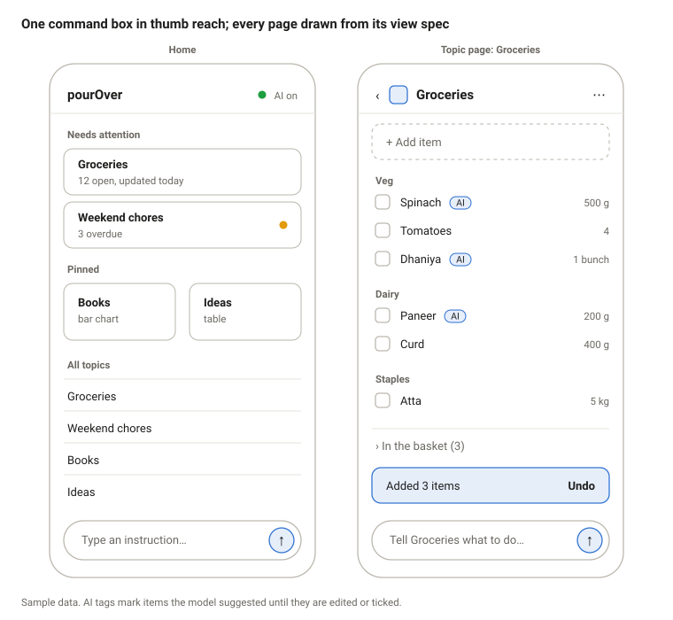

# Design spec

pourOver is designed for a phone held in one hand in a shop: one command box in thumb reach, big tap targets, and every page drawn from its view spec.

## Principles

1. **Text first, taps always.** Anything typed can also be tapped, and taps never wait on the model.
2. **Show before you change.** Additive changes land with an undo; destructive ones show exactly what goes.
3. **The page fits the topic.** Groceries look like a list, books look like a chart. The kit is small so every page still feels like one app.
4. **Full of features, light by feel.** The screen shows the list and the command box; every other feature waits in the box or a menu, or appears only when it applies. One accent per topic, no badges unless they need action.
5. **Honest about AI.** AI-suggested items are tagged, AI status is always visible, and failures say nothing changed.

## Mockup

The grocery page is the checklist widget grouped by category. The same page as a table or bar chart is one set_view away.

## Screen inventory

Seven screens in v1. The command box appears on Home and every topic page, scoped to that topic.

| Screen | Contents | Notes |
| --- | --- | --- |
| Home | AI status, needs attention (up to 3 cards with reasons), pinned tiles, all topics, command box | Default landing page |
| Topic page | Header (icon, title, menu), quick-add row, sections from the view spec, command box | Menu: rename, pin, export, archive |
| Confirm sheet | Bottom sheet listing every item or field that will go, with a red action and a default-focused cancel | Only for destructive plans |
| Clarify chips | Inline choices when a name matches more than one item | Picking one re-runs the plan |
| Item editor | Title, fields from the topic schema, delete | Opens on tapping an item's text |
| Command history | Recent commands with outcome badges; undo on the latest | Reached from the header menu |
| New topic | Template picker for people who'd rather tap than type | Same result as "new topic …" |

## Widget look and behaviour

| Widget | Look | Behaviour |
| --- | --- | --- |
| Checklist | Rows of 48 px: checkbox, title, AI tag if suggested, key field right-aligned in quiet text; group labels in small caps | Tap box to tick; tap text to edit; done items move to a collapsed "In the basket" or "Done" section |
| Table | Sticky header, zebra-free rows, numbers right-aligned with units in the header | Tap a row to edit; on phones, columns past the third scroll sideways inside the widget, never the page |
| Bar chart | Server SVG, bars in the topic accent, value labels on bars, no gridlines beyond a baseline | Tap a bar to list the items behind it |

Every widget has a title, an empty state, and a "can't draw this section" fallback card.

## Theme tokens

Warm neutrals plus one accent per topic, with light and dark modes that follow the system. Hex values are starting points, to be checked against contrast in M3.

| Token | Light | Dark | Use |
| --- | --- | --- | --- |
| milk (canvas) | #FAF7F2 | #17110D | Page background |
| cup (surface) | #FFFFFF | #211913 | Cards, sheets, command box |
| espresso (text) | #2B1D14 | #F3EDE6 | Body text |
| crema (quiet text) | #6B5B4E | #B3A396 | Secondary text, labels |
| grounds (border) | #E6DDD3 | #3A2E25 | Borders, dividers |

Topic accents, one per topic: matcha #4F7D3A, chai #B5651D, filter #2F6690, berry #7A3E6E, mocha #6F4E37, rose #B24C5A. Dark mode uses a lighter step of each. An accent never carries meaning alone; status always has a word next to it.

| Scale | Values |
| --- | --- |
| Type (system font stack) | Title 22/600, section 17/600, body 16/400, small 13/400 |
| Spacing | 4, 8, 12, 16, 24, 32 |
| Radius | 10 for cards, 22 for the command box |
| Density | Comfortable: 48 px rows; compact: 44 px rows, the tap-target floor |

Body text stays at 16 px so phone browsers don't zoom into the command box.

## Interactions

- **Command box.** Pinned to the bottom on phones, top on desktop. Enter sends. On a topic page the placeholder names the topic, and commands default to it.
- **Waiting.** Fast-path results appear at once. Model commands show "Brewing…" in the box, and the page stays usable meanwhile.
- **After an additive change.** A toast says what happened ("Added 3 items") with Undo for 10 seconds. Undo stays available later from Command history.
- **AI-suggested items.** Tagged "AI" until edited or ticked, so a wrong guess is easy to spot in the shop.
- **Destructive change.** The confirm sheet lists everything affected. The action button names the count ("Remove 7"); Cancel has focus.
- **Ambiguity.** Chips appear under the box ("Two items match milk. Which one?"). Nothing changes until one is picked.
- **Shared lists.** A page refreshes when it regains focus and every 30 seconds while open, so two people in one shop see each other's ticks.

## States and copy

Short, plain, and always says whether anything changed.

| State | Copy |
| --- | --- |
| AI offline | "AI is napping. Taps and simple commands still work." |
| Model working | "Brewing…" |
| Additive done | "Added 3 items to Groceries." + Undo |
| Confirm | "Remove 7 items from Groceries? They're kept for 30 days before they're gone." Buttons: "Remove 7", "Keep them" |
| No plan | "Couldn't turn that into changes. Nothing changed. Try: add eggs to groceries" |
| Ambiguous | "Two items match milk. Which one?" |
| Section can't render | "Can't draw this section. Your data is safe; change the view to fix it." |
| Empty home | "No topics yet. Try: new topic groceries" |
| Empty topic | "Nothing here yet. Type what to add, or tap Add item." |

## Accessibility

- WCAG 2.1 AA contrast for text in both modes; accents at least 3:1 for non-text marks.
- 44 px minimum tap targets in both densities.
- Full keyboard use on desktop: / focuses the command box, Esc closes sheets, visible focus rings.
- Checkboxes are real inputs with labels; charts carry a text summary for screen readers.
- Motion limited to the toast and sheet, and off when the system asks for reduced motion.
