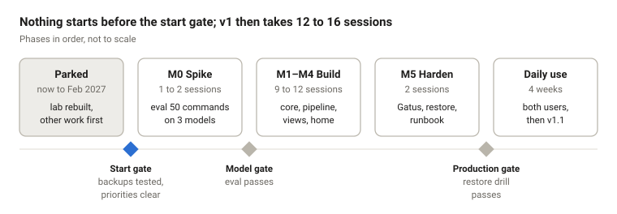

# Plan

All start gates cleared 2026-10-14 (gate 2 bypassed with a guardrail). M0 can start. The rest of this file still describes the pre-stir-3 milestones and is due a rewrite to the translator shape.

## Start gates

Revised 2026-10-14 for the stir-3 translator shape (see [ideas/pourover.md](ideas/pourover.md)). M0 starts when every box is ticked or explicitly bypassed.

- [x] purrBrews rebuilt, with a restore-tested backup (owner, 2026-10-14)
- [x] ~~Owner's higher-priority commitments clear~~ Bypassed by owner, 2026-10-14. Guardrail (owner's choice): until 8 Nov, pourOver may use any free time, but unfinished work then waits; from 9 Nov it gets only the weekly purrBrews slot, max 4 sessions for v1, and never displaces the job-switch sprint
- [x] Model path: roastery on demand (about 99% uptime since joining the fleet); kettle stays a later upgrade. Model pick is settled by the M0 eval
- [x] Stir-3 defaults confirmed (owner, 2026-10-14): reminders via Vikunja CalDAV to native phone apps; v1 commands are add / done / what's due (reports all tasks) / delete (sender's own tasks only, with a confirm step); meowGram is the input (treat its bot hook as available), ntfy is output only (replies, errors, queued results); own public repo under purrMonster, stack in purrbrews-containers
- [x] meowGram running (on cellar); its bot hook ships with the next release and is treated as available

## Roadmap

A failed model gate doesn't stop the build: v1 continues fast-path only, and the model joins later.

## Milestones

Six milestones, each ending in evidence rather than a feeling. A session is one 2 to 3 hour block.

| ID | Scope | Exit evidence | Sessions |
| --- | --- | --- | --- |
| M0 Spike | Write 50 commands from real lists; run them against Gemma 4 12B, Qwen3.5 9B and the game-mode 4B with schema-constrained output | Eval report committed. Go if one model meets the thresholds; otherwise v1 ships fast-path only | 1 to 2 |
| M1 Core | Topics, items, templates, checklist and table widgets, fast path, two users, running on grinder behind Authelia | Both users use the grocery list for a week with zero model calls | 3 to 4 |
| M2 Pipeline | Model client, plan schema, validator, preview and confirm, command log, undo | The eval set passes through the real pipeline; every destructive plan stops at confirm | 3 to 4 |
| M3 Views | View spec, set_view, bar chart, theme tokens, contrast check | Every template's view switches by text at 360 px and desktop widths | 2 to 3 |
| M4 Home | Pinned topics, needs-attention scoring with reasons | Home loads under 1 s; every reason matches the data | 1 |
| M5 Harden | Gatus check, backup and restore drill, runbook entry, MAP update, then promote to percolator | Restore drill passes; dated runbook entry | 2 |

Total: 12 to 16 sessions. M1 is deliberately useful without any AI, so a failed M0 still leaves a working list app.

## Calendar and time budget

pourOver gets the weekly purrBrews slot and nothing else. At one session a week, v1 takes 3 to 4 months, so a February start lands around May or June 2027.

- **purrBrews upkeep shares the same slot.** If upkeep takes every other week, v1 stretches to 6 to 8 months. That's fine.
- **If something has to slip, pourOver slips.** Higher-priority work and a working home lab come first.

## Risks

| Risk | What it would cost | Mitigation |
| --- | --- | --- |
| Small model writes bad plans | Wrong items, lost trust | M0 eval gate, schema-constrained output, fast path, confirm on deletes |
| roastery off or gaming | AI commands fail | Fast path and taps keep working; offline banner; AI node later |
| Scope creep from the v2 list | v1 never ships | v1 scope frozen in README.md; new ideas go to the v2 row, not the build |
| Polishing loop | Weeks on CSS nobody asked for | Each milestone stops when its exit evidence passes |
| Half-baked for the second user | They stop using it | They join at M1, when the list works with no AI; taps always beat typing |
| Data loss | Lists gone | Soft deletes, undo journal, restore drill before production |
| Prompt injection through item text | Unwanted changes | Text fenced as data, no model tools, confirm on cross-topic changes |

## Good enough, and next step

v1 is good enough when the grocery list survives a full week of real shopping for both users with no fixes. Stop there. v1.1 starts only after 4 weeks of daily use.

Next step: none until the start gates are ticked. Then M0, starting with writing the 50 eval commands from real lists.
